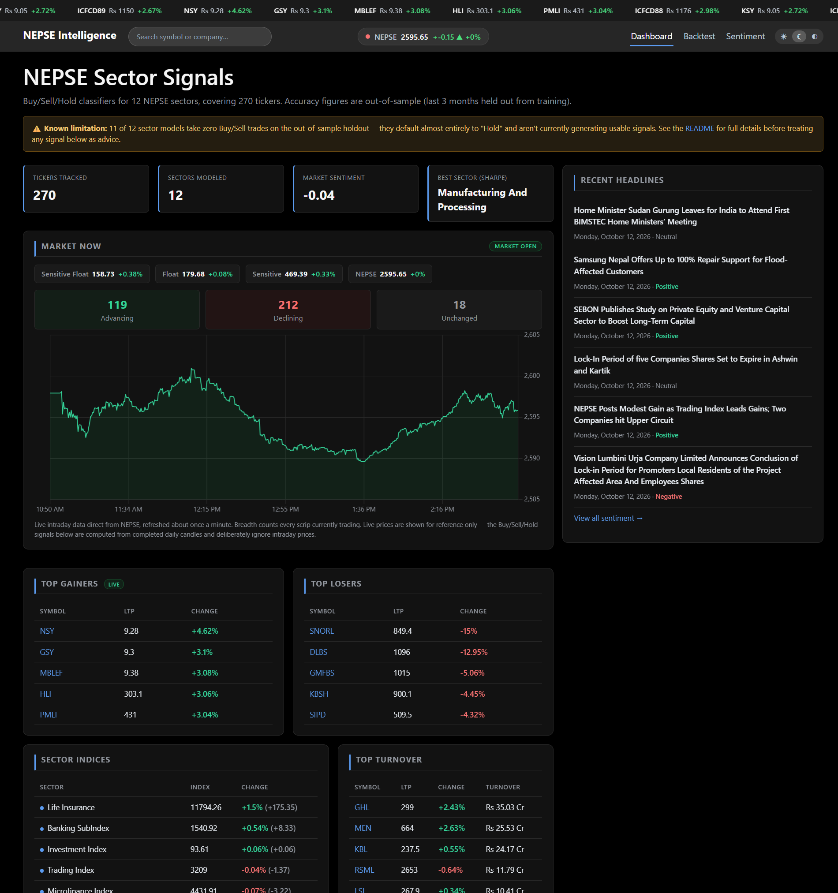

# 🇳🇵 NEPSE Intelligence Platform

> An end-to-end Machine Learning platform for Nepal Stock Exchange (NEPSE) analysis — combining price forecasting, Buy/Sell/Hold signal classification, and financial news sentiment analysis in a single Flask web dashboard.



## 🎯 What it does

| Feature | Description |
|---|---|
| 📈 Price Forecasting | Prophet + LSTM models predict next 7-day stock prices |
| 🟢 Signal Classification | XGBoost/LightGBM classify Buy / Sell / Hold signals |
| 📰 News Sentiment | NLP pipeline scores financial news from Sharesansar & OnlineKhabar |
| 💡 Explainability | SHAP values explain every prediction ("why Buy?") |
| 📊 Backtesting | Simulated trading vs. Buy-and-Hold benchmark |
| 🌐 Web Dashboard | Interactive Flask app with Chart.js visualizations |

## 🛠 Tech Stack

`Python` · `Flask` · `XGBoost` · `LightGBM` · `Prophet` · `TensorFlow/Keras` · `HuggingFace Transformers` · `SHAP` · `Optuna` · `BeautifulSoup` · `Chart.js` · `Bootstrap 5`

## 📁 Project Structure

```
nepse_intelligence/
├── config/                  # YAML configuration files
├── src/
│   ├── scraper/             # NEPSE & news web scrapers
│   ├── features/            # Technical indicators & labeling
│   ├── nlp/                 # Sentiment analysis pipeline
│   ├── models/              # Forecaster & classifier
│   └── backtesting/         # Strategy simulation
├── app/                     # Flask web application
│   ├── templates/           # HTML pages
│   └── static/              # CSS, JS, Chart.js
├── data/
│   ├── raw/                 # Scraped CSV files
│   ├── processed/           # Feature-engineered data
│   └── models/              # Saved model files
├── notebooks/               # EDA & modeling experiments
└── examples/                # Standalone usage scripts
```

## 🚀 Getting Started

```bash
# 1. Clone the repository
git clone https://github.com/roshanpandey-1/nepse-intelligence.git
cd nepse-intelligence

# 2. Create virtual environment
python -m venv venv
source venv/bin/activate  # Windows: venv\Scripts\activate

# 3. Install dependencies
pip install -r requirements.txt

# 4. Fetch stock data
python examples/fetch_stock_data.py

# 5. Run the web app
python run.py
# Open http://localhost:5000
```

## 📊 Model Performance

Buy/Sell/Hold classifiers, one per NEPSE sector (LSTM for 7 sectors, XGBoost for
Manufacturing And Processing). Trained on a rolling 2-year window ending
Sept 2026, with a chronological holdout (last 3 months, never seen during
training) used for the accuracy figures below — not a random split, so these
numbers reflect real forward-looking performance rather than in-sample memorization.

| Sector | Model | Holdout Accuracy | Sell Recall | Buy Recall |
|---|---|---|---|---|
| Commercial Banks | LSTM | 71.3% | 0.00 | 0.00 |
| Life Insurance | LSTM | 69.6% | 0.01 | 0.00 |
| Development Banks | LSTM | 64.3% | 0.32 | 0.02 |
| Finance | LSTM | 60.2% | 0.01 | 0.00 |
| Manufacturing And Processing | XGBoost | 59.8% | 0.19 | 0.15 |
| Non Life Insurance | LSTM | 58.9% | 0.00 | 0.00 |
| Microfinance | LSTM | 57.7% | 0.04 | 0.00 |
| Hydro Power | LSTM | 53.6% | 0.00 | 0.00 |

### ⚠️ Known limitation: majority-class collapse

The accuracy numbers above look reasonable at a glance, but most of that is the
model defaulting to "Hold" for nearly every prediction — the Buy/Sell/Hold
label distribution is Hold-dominated, and without class weighting the model
learns that predicting Hold is the lowest-risk strategy. **6 of 8 sectors have
near-zero Sell/Buy recall on the holdout set**, meaning they are not currently
generating usable trading signals; only Manufacturing, and to a lesser extent
Development Banks, meaningfully use all three classes.

Two fixes were attempted and did not resolve this:
- **Data noise removal** (dropping short-history tickers and unadjusted
  bonus/rights-share price artifacts, with a NEPSE-rule-aware threshold — 10%
  daily limit before Apr 20 2026, 15% after): improved data quality but moved
  holdout accuracy by <1% in every sector.
- **Percentile-based labeling** (Sell/Hold/Buy assigned by the 30th/70th
  percentile of each ticker's forward return, instead of a fixed ±1%
  threshold): fixed the collapse in 4 of 8 sectors but lowered overall accuracy
  and left the other 4 still collapsed, so it was reverted.

The next thing worth trying is class-weighting in the training loss, which
directly targets the imbalance rather than the labeling scheme — not yet
implemented.

## ⚠️ Disclaimer

This tool is for **educational purposes only** and does not constitute financial advice. Past model performance does not guarantee future returns. Always consult a licensed financial advisor before making investment decisions.

## 👤 Author

**Roshan Pandey** · [roshanpandey-1.github.io](https://roshanpandey-1.github.io) · [GitHub](https://github.com/roshanpandey-1)
